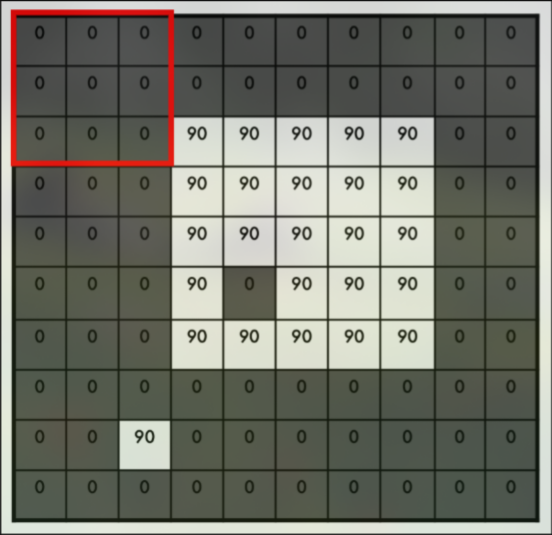
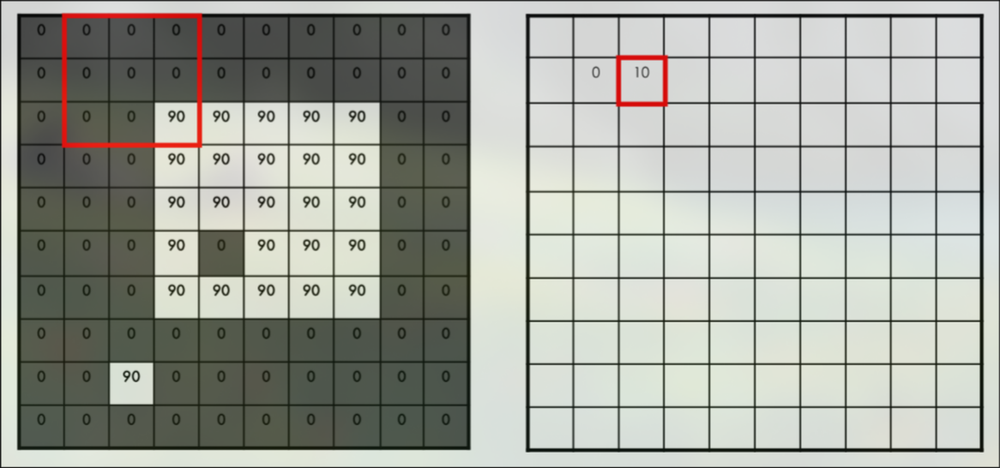
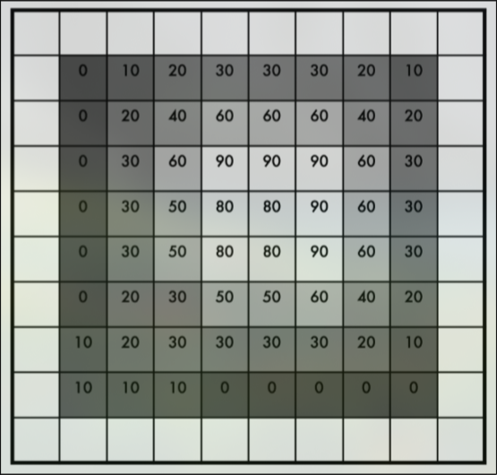
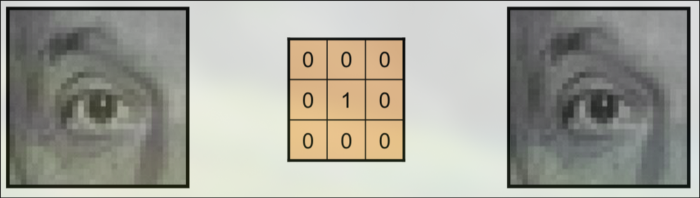
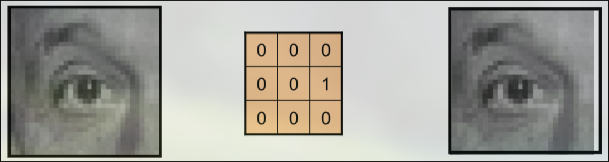
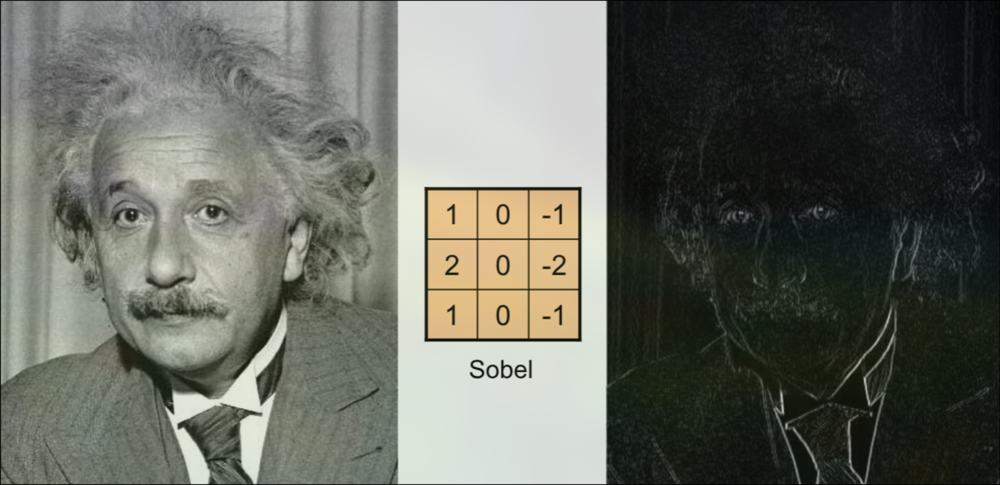

# Convolution
In the context of CNNs, a convolution is the application of a convolution filter/kernel to an input. The kernel slides over the input data spatially to transform it. Most commonly, we use convolution in the 2D case, in which a 2D kernel slides over a 2D image. For example, a 3x3 kernel:

$$\text{kernel}= \frac{1}{9}
\begin{bmatrix}
1 & 1 & 1 \\
1 & 1 & 1 \\
1 & 1 & 1
\end{bmatrix}
$$

This kernel will be slid over the pixels of an image, in both the x and y dimensions. For a single kernel computation, the kernel will occupy a 3x3 region on the image. Each pixel value is multiplied by the corresponding kernel value, then all the products are summed to get an output value for that region.

For a 10x10 image, the 3x3 kernel can be placed at 8x8 positions, since the kernel must be fully contained within the image. This produces an 8x8 output. The above kernel is known as a box blur, as it creates a blurred output image by averaging all the pixels in each region. 

## Example Filters

### Identity
This filter leaves the image unchanged, but it may crop the edges if no padding is used. 

$$\text{kernel}=
\begin{bmatrix}
0 & 0 & 0 \\
0 & 1 & 0 \\
0 & 0 & 0
\end{bmatrix}
$$

### Translate Left
This filter produces an image with all the pixels shifted left by one pixel. 

$$\text{kernel}=
\begin{bmatrix}
0 & 0 & 0 \\
0 & 0 & 1 \\
0 & 0 & 0
\end{bmatrix}
$$

### Sobel Vertical Edge Detection 
This filter produces an image that highlights the vertical edges (it responds to horizontal changes in intensity). 

$$\text{kernel}=
\begin{bmatrix}
1 & 0 & -1 \\
2 & 0 & -2 \\
1 & 0 & -1
\end{bmatrix}
$$

