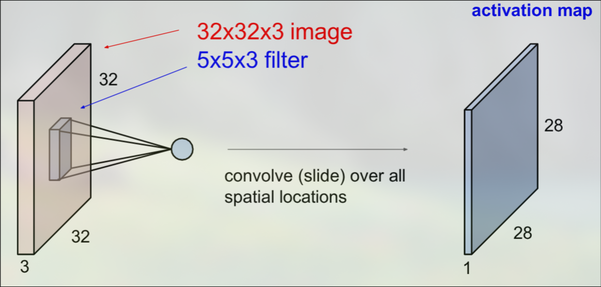
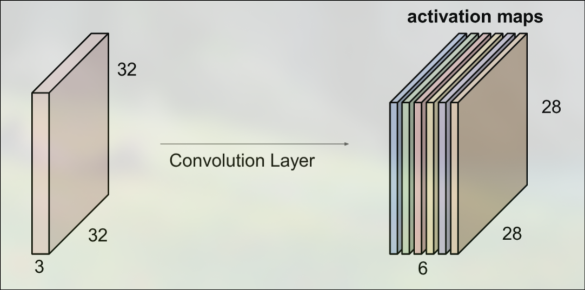
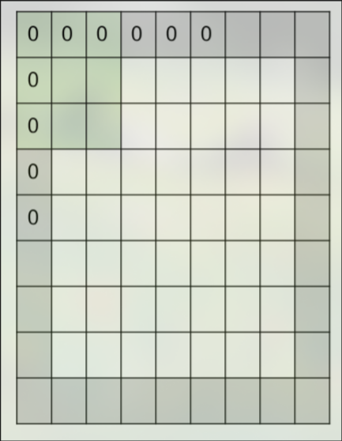
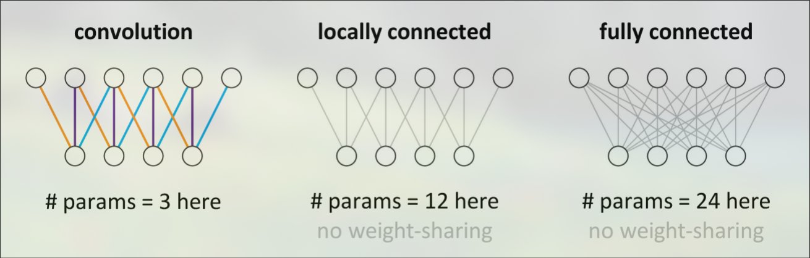
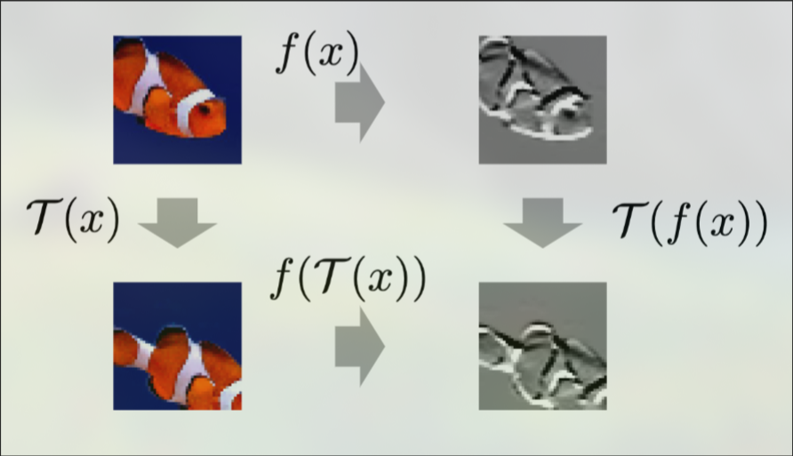

# The Convolutional Layer
A convolutional neural network (CNN) is a neural network with at least one convolutional layer. A convolutional layer takes in a set of images, commonly referred to as feature maps, and applies $n$ convolution kernels to them, producing $n$ output feature maps, otherwise known as activation maps. In a convolutional layer, the parameters of the kernels are trainable. This structure is well suited for image classification, as it can extract important information like edges while having relatively few tunable parameters compared to a fully connected layer due to weight sharing across spatial positions. 

It is helpful to note that what we call convolution here is actually cross-correlation. However, based on how we learn the layer, this distinction is not super important. 

## Feature Maps
It is important to understand how a convolutional layer takes input feature maps to produce output feature maps. We will describe the input in three dimensions: x, y, and depth. For example, a 32x32x3 image may represent a 32 by 32 image with 3 color channels (RGB). 

Every kernel must have the same depth as the input. In the above RGB example, our kernels will typically be 3x3x3 or 5x5x3. The parameters in each channel of a kernel are independent. The results of each channel's kernel operation are summed together to produce a single 2D feature map. So if we have a 32x32x3 image and apply a 5x5x3 kernel with no padding, the output will be a 28x28x1 activation map. 

We can produce more output activation maps by increasing the number of kernels in the layer. The number of output maps will be equal to the number of kernels. For example, if we have a 32x32x3 image and apply six 5x5x3 kernels, the output will be a 28x28x6 activation volume.

## Padding
A convolution can only be applied to a full patch of pixels, so any kernel larger than 1x1 cannot be applied to the entire image; we can't have kernel pixels hanging off the image. Because of this, the convolution will reduce the size of the output image. The amount of this decrease is determined by the kernel size. Intuitively, a 3x3 convolution will reduce the x and y dimensions by 2, since we will lose one pixel at each border. Likewise, a 5x5 will reduce the image by 4 on each axis. This reduction is not always desirable, especially for larger networks, so we will introduce padding to solve this. Padding adds extra pixels to the border of the image so we can convolve over the entire image. Typically, these pixels will just be set to 0, but there are certainly other ways to determine the value of the padded pixels.

This allows the dimension of the image to be preserved. The number of border pixels is given by the floor of the kernel size divided by 2.

$$\text{padding} = \lfloor \frac{k}{2} \rfloor$$

This assumes odd $k$ and stride of 1.

## Stride
By default, the kernel convolves over the image by sliding over every pixel of the image one by one. However, we will sometimes want to "skip" over some pixels. We do this by introducing a stride, which determines how far the convolution moves between patches. The default stride is 1. Increasing the stride will lead to smaller output images, as there are fewer convolutions computed. In general, the size of the output image, considering the size of the kernel $k$, stride $s$, border padding pixels $p$, and input size $N_{in}$ is given by:

$$N_{out} = \lfloor \frac{N_{in} +2p - k}{s} \rfloor + 1$$

## Number of Trainable Parameters
It is important to note the number of trainable parameters in a given convolutional layer. Convolution is a special case of local connection and weight sharing. This setup allows for each layer to process large images with relatively few trainable parameters. 

In general, the number of parameters is defined by the kernel size $k$, number of input feature maps $M_{in}$, and number of output feature maps $M_{out}$:

$$\text{parameters} = M_{out} \cdot (M_{in} \cdot k^2 + 1)$$

The plus one is the bias for each output map. 

## Convolution Equivariance
Convolution is said to be equivariant under translation. That is, given an image, it is equivalent to convolve then translate and to translate then convolve. Formally:

$$\text{conv}(\text{translation}(x)) = \text{translation}(\text{conv}(x))$$

However, it is important to note that this property does not hold for rotational transformations. Because of this, it is much easier to learn translations than rotations. 

Note that translation equivariance only holds for translations that are multiples of the stride. For stride 1, this is all translations, but for larger strides, less translations are considered equivariant.

## Backpropogation
TODO