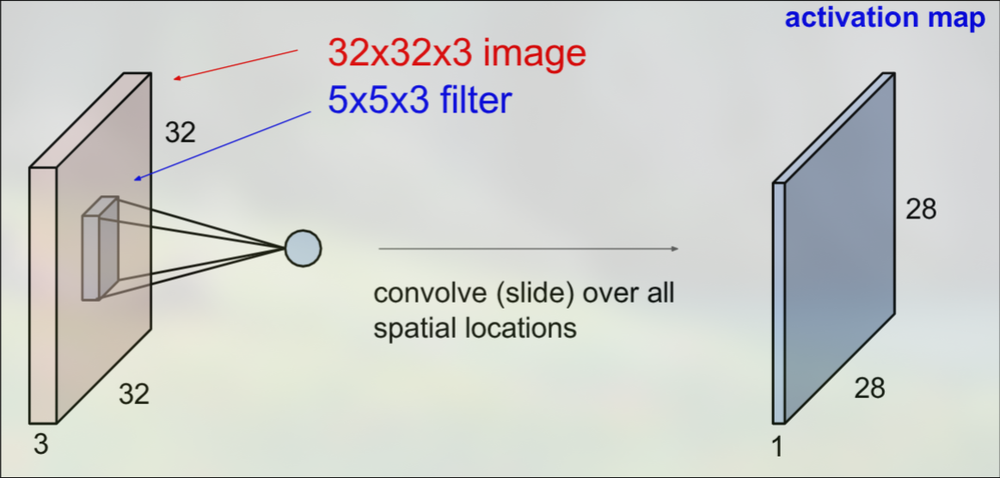
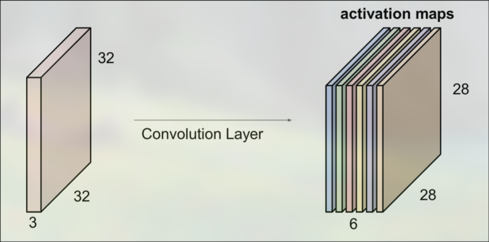

# The Convolutional Layer
A convolutional neural network (CNN) is a neural network with at least one convolutional layer. A convolutional layer takes in a set of images, commonly referred to as feature maps, and applies $n$ convolution kernels to them, producing $n$ output feature maps, otherwise known as activation maps. In a convolutional layer, the parameters of the kernels are trainable. This structure is well suited for image classification, as it can extract important information like edges while having relatively few tunable parameters compared to a fully connected layer, due to weight sharing across spatial positions. 

## Feature Maps
It is important to understand how a convolutional layer takes input feature maps to produce output feature maps. We will describe the input in three dimensions: x, y, and depth. For example, a 32x32x3 image may represent a 32 by 32 image with 3 color channels (RGB). 

Every kernel must have the same depth as the input. In the above RGB example, our kernels will typically be 3x3x3 or 5x5x3. The parameters in each channel of a kernel are independent. The results of each channel's kernel operation are summed together to produce a single 2D feature map. So if we have a 32x32x3 image and apply a 5x5x3 kernel with no padding, the output will be a 28x28x1 activation map. 

We can produce more output activation maps by increasing the number of kernels in the layer. The number of output maps will be equal to the number of kernels. For example, if we have a 32x32x3 image and apply six 5x5x3 kernels, the output will be a 28x28x6 activation volume.

