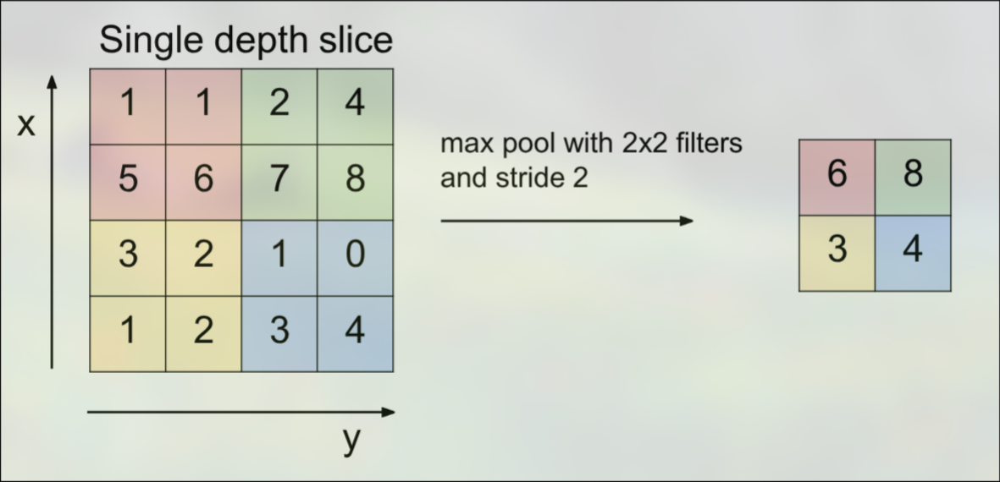

# Pooling
Convolutional layers often have to compute a large amount of data which may not be necessary for prediction. Many image features do not need the full image size to be learned and represented, so it can be helpful to periodically reduce the size of the image. These smaller representations are more manageable for the model to learn. This is done with pooling layers. 

## Max Pool Layers
The most common form of a pool layer is the max pool layer. It divides the input image into smaller squares, which will become the pixels of the output. The value of the output pixel is simply set to the max of the pixels in the input:

This operation is applied to each layer of the image, rather than across all layers. 

### Backpropogation
Backpropogation through the max pool layer is relativly simple. Conceptually, only one pixel, that which was the max, will contribute to the loss. Because of this, we only pass the loss gradient through the max pixel, with all other pixels getting 0. To do this, the max mask from the forward pass must be kept until the backward pass. 