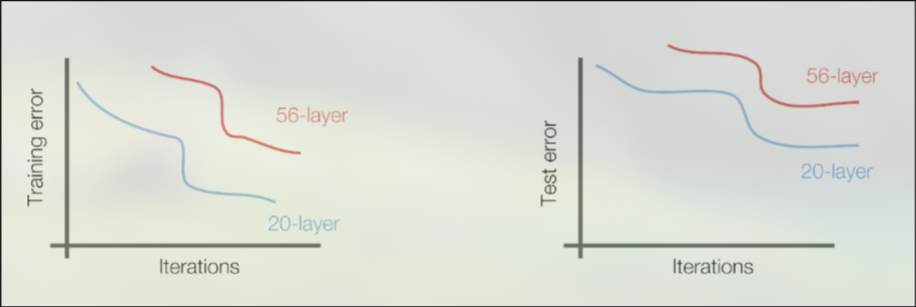
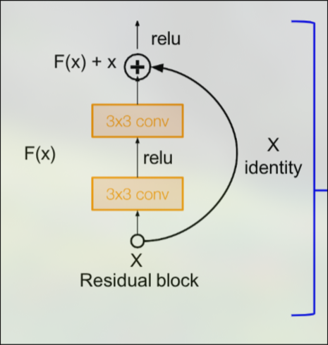

# Residual Blocks
Residual blocks were introduced by Kaiming He with the ResNet architecture. A key insight is that CNNs are often difficult to train with many convolutional layers, and can actually perform worse than smaller models. This is not an overfitting issue, as both the training and the testing loss can be higher in the bigger model. The solution to this is to use network layers to fit a residual mapping instead of directly trying to fit a desired underlying mapping. This is done with the residual block. 

A residual block takes in an input $x$, then runs a sequence of neural network to obtain $f(x)$, then adds the original input to the output:

$$z = f(x) + x$$

This simple addition allows the model to learn much more efficiently with many layers. 

## Dealing with Dimension Changes
One tricky aspect of the residual block is that the output dimesions may differ from the input dimensions. In a CNN, the solution to this is to use a 1x1 convolution with a stride on the original input. 