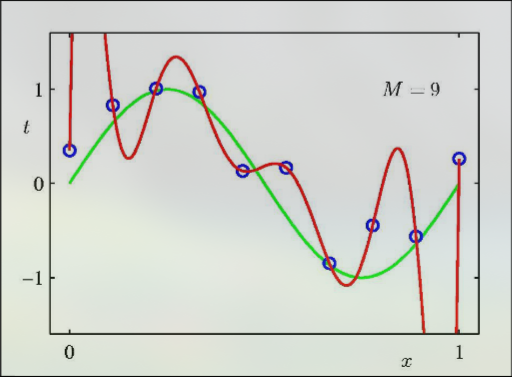
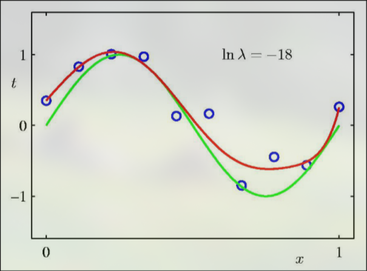

# Regularization
Regularization is a technique used to minimize overfitting. It does this by introducing a penalty term in the loss function to discourage weights with large magnitudes:

$$
\begin{aligned}
\tilde{E}(w) &= E(w) + \frac{\lambda}{2}\|w\|_2^2 \\
\|w\|_2^2 &= \sum_{i=0}^d w_i^2
\end{aligned}
$$

This form of regularization is known as L2. L2 is the most common form of regularization, and is widely used for logistic regression and neural networks. The $\lambda$ factor is a hyper-parameter used to control the relative importance of the regularization term. 

## Intuition
Intuitivly, applying regularization minimizes overfitting by reducing complexity, essentially flattening the learned function. Take the given overfit graph:

Though the in-sample error is very low, the learned function is overfit, wildly oscillating, and certainly a poor aproximation of the truth. It fits to the noise in the training data, not the actual function. Applying regularization produces the following graph:

This approximation is far more accurate and much less complex. 