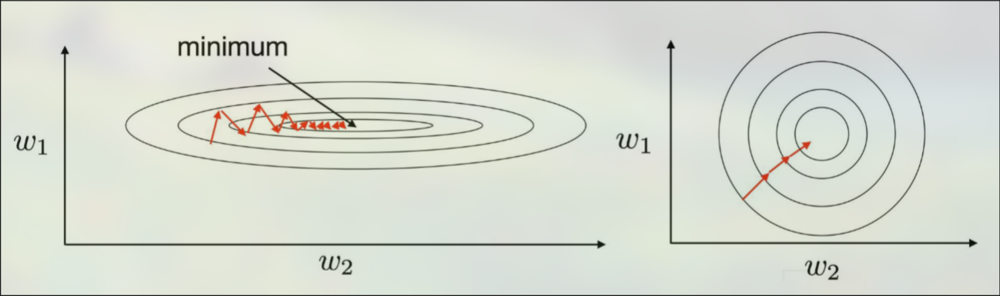

# Normalization
Normalization is a preprocessing technique that rescales input features to a common scale. In this document, I will use standardization (z-score normalization), which results in data with a mean of $0$ and a standard deviation of $1$, though there are other forms of normalization as well. Normalization is useful because input features often have wide ranges of observed values, with some features having larger ranges and magnitudes than others. For example, *age* and *salary* may both be inputs, but salary is generally orders of magnitude larger than age. This imbalance makes gradient descent tricky: the loss surface becomes elongated, so a learning rate that is stable for the large-scale features is too slow for the small-scale ones, and a rate that suits the small-scale features can cause oscillation or divergence along the large-scale ones. By normalizing the inputs, these problems are largely mitigated.

## Training
To train with normalization, a mean $\mu$ and standard deviation $\sigma$ must be calculated from the training data. Each input feature has its own mean and standard deviation. For example, for all values of *age*, calculate the mean and standard deviation.

With the mean and standard deviation for each feature $c$, apply the normalization formula element-wise:

$$\hat{x}_{i,c} = \frac{x_{i,c} - \mu_c}{\sigma_c}$$

where $i$ indexes the sample and $c$ indexes the feature.

Note that test data **cannot** be used in this computation, as doing so would leak information about the test set into training (data leakage).

## Prediction
To make a prediction with the model, all inputs must be normalized as they were in training. To do this, use the means and standard deviations calculated from the training data. Do not re-compute these values with test data.