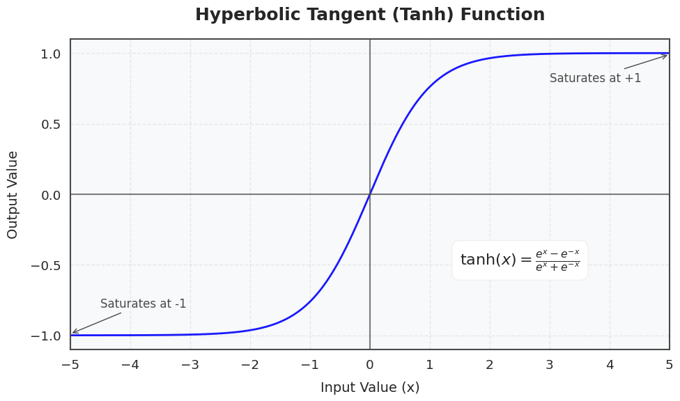
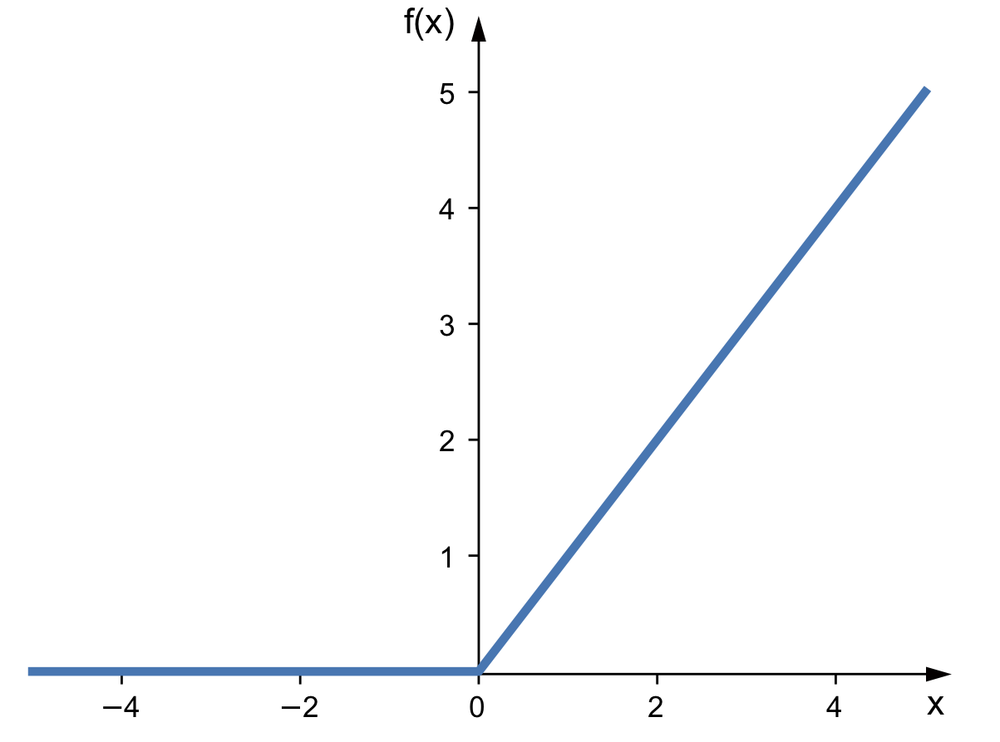

# Activation Functions
Activation functions are the basic non-linear layers in a machine learning model. The non-linearity of these functions allows us to learn more complex behaviour than we can with purely linear models. Some (like sigmoid and tanh) squash their inputs into a bounded range, while others (like ReLU) do not.

## Use in a Neural Network
When we use an activation function layer in a neural network, we will generally need to do two things with it: pass input forward and propagate gradient backward. The forward propagation is simple, just apply the non-linear function element-wise to the input. For backpropagation, we can treat the derivative of the activation as its own function, then apply that to the input element-wise. Because of the need to take the derivative, differentiability is a desirable trait for activation functions, though, as we will see, it is not strictly required. 

# Common Activation Functions
We will now cover a few of the most common activation functions and their gradients.

## Tanh
One of the simplest activation functions is tanh. This is a standard hyperbolic trigonometric function that has the desirable squashed shape. However, one problem with tanh is that it kills the gradient at high values of $x$, making it harder to train with. 

### Forward of tanh
$$\theta(s^{(\ell)}) = \tanh(s^{(\ell)}) = x^{(\ell)}$$

### Gradient of tanh
$$\theta'(s^{(\ell)}) = 1 - \tanh^2(s^{(\ell)})$$

## ReLU
ReLU (Rectified Linear Unit) is one of the most widely used activation functions. ReLU is simply 0 when the input is less than 0, and identity when the input is greater than 0. Unlike tanh, this produces constant gradient for all values of $s$ greater than 0, making it easier to train with. However, this function is non-differentiable, so it requires some tricks to use during training:

### Forward of ReLU
$$\theta(s^{(\ell)}) = \max(0, s^{(\ell)}) = x^{(\ell)} $$

### Gradient of ReLU
Though ReLU is non-differentiable, we can use subgradients to use it in training. One easy solution is to simply pick a gradient value at 0 (where it is mathematically undefined), like $0$, $0.5$ or $1$. 

$$
\theta'(s^{(\ell)}) = 
\begin{cases} 
1 & \text{if } s^{(\ell)} > 0 \\
0 & \text{if } s^{(\ell)} <\ 0 \\
c & \text{if } s^{(\ell)} = 0 
\end{cases}
$$

