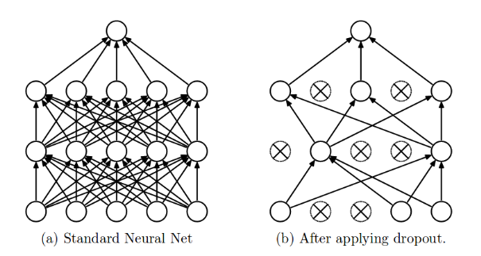

# Dropout
Dropout is a regularization technique commonly used to combat overfitting in neural networks. Intuitively, it works by training an ensemble of subnetworks, then averaging their results during prediction.

# Training
During training, dropout will select a set of neurons to "deactivate", sending zero signal forward and no gradient backward. This set is randomly chosen in each batch, with each neuron having an equal and independent probability $p$ of being deactivated. Because no signal gets through these selected neurons, this essentially creates a smaller subnetwork to be trained individually. Each surviving neuron's output is also divided by $(1 - p)$ so that its expected value is unchanged (more on why below).

We can think of these subnetworks as an ensemble that shares weights. At prediction time, we use the full network with scaled signals, which approximates averaging the predictions of all the subnetworks. By randomly dropping out neurons during training, we prevent co-adaptation of neurons, meaning neurons cannot rely on neurons being present.

# Prediction
During prediction, dropout is turned off, allowing all neurons to send signal. However, this would send much more signal than we saw during training, so we need a way to correct this. A simple solution is to multiply all of the neuron outputs by $(1 - p)$, since this is the probability each neuron would stay activated. Intuitively, this averages out the signal, dampening it to what we would have expected during training, $x\cdot(1 - p)$. However, it is often not desirable to do this extra computation during prediction, so we can use a clever implementation trick during training. Instead of passing the value of activated neurons directly, we will divide them by $(1 - p)$, effectively boosting their signal. By doing this, we can treat dropout as an identity layer during prediction.