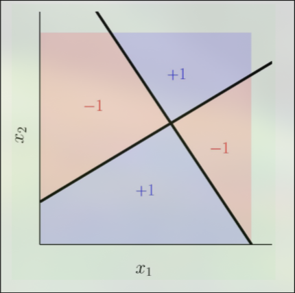
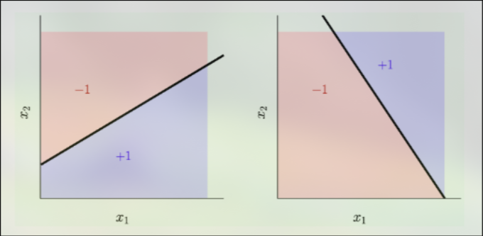
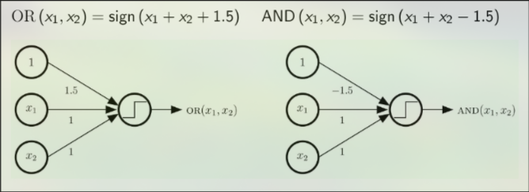
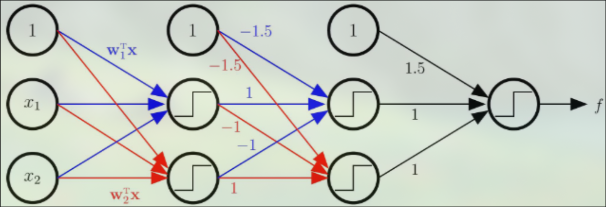
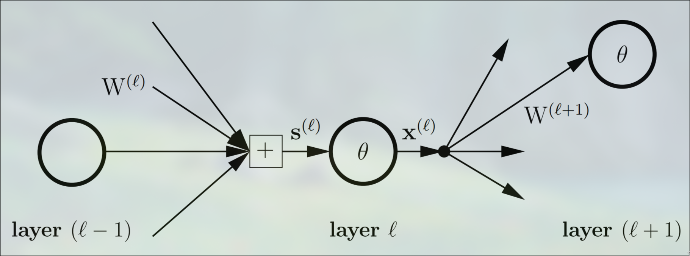

# Neural Networks
Neural networks are the fundamental deep learning model, used to build many more complex models.

## Non-Linearity
Neural networks are not linear, allowing them to model more functions than linear models. This added capability this the primary motivation behind neural networks. Take XOR for example:

It is imposible to model XOR with a linear model because the two classes, true and false, are not linearly seperable. However, XOR can be decomposed into two linear functions:

This means we can express XOR using multiple layers linear models. The perceptron can easily be used to model other logic functions, namely OR, NOT, and AND. 

Conveniently, we can express XOR in terms of OR, NOT, and AND:

$$XOR(x_1, x_2) = x_1 \overline{x_2} + \overline{x_1} x_2$$

Thus, to implement XOR we can use multiple perceptron layers. The intermediate layers are known as **hidden layers**:

This is what is historically know as a **multi-layer perceptron (MLP)**. However, the use of the non-differentiable $sign()$ function makes this model difficult. To fix this issue, modern neural networks replace $sign()$ with $tanh()$. This function is similar to the perceptron model and allows us to use gradient descent.

## Notation
For further discussion, it is crucial to define some notation. Typically, notation is given in terms of the layer $\ell$:

|             | Symbol          | Dimensions                                              |
|-------------|-----------------|---------------------------------------------------------|
| signals in  | $s^{(\ell)}$    | $d^{(\ell)}$ dimensional input vector                   |
| outputs     | $x^{(\ell)}$    | $d^{(\ell)} + 1$ dimensional output vector              |
| weights in  | $W^{(\ell)}$    | $(d^{(\ell-1)} + 1) \times d^{(\ell)}$ dimensional matrix |
| weights out | $W^{(\ell+1)}$  | $(d^{(\ell)} + 1) \times d^{(\ell+1)}$ dimensional matrix |

It is important to note that the bias is encoded in the weights in the same way we did for the linear models. That is, $x_0$, for all layers, is always set to $1$, and $w_0$ encodes the bias. This is why the weight matricies have dimensions of the form $d + 1$, the bias is the additional term. Importantly, we never send any signal into the bias, as we know it will be set to $1$.

## Number of Tunable Parameters
A useful excersize for building understanding the structure of a neural network is calculating the number of tunable parameters (weights and biases) in the network. 

## Forward pass

$$s^{(\ell)} = (W^{(\ell)})^T x^{(\ell-1)}$$

$$x^{(\ell)} = \begin{bmatrix} 1 \\ \theta(s^{(\ell)}) \end{bmatrix}$$

## Backpropagation

$$\delta^{(\ell)} = \theta'(s^{(\ell)}) \otimes \left[ W^{(\ell+1)} \delta^{(\ell+1)} \right]_1^{d^{(\ell)}}$$

$$\delta^{(L)} = 2(x^{(L)} - y)\,\theta'(s^{(L)})$$

$$\frac{\partial E}{\partial W^{(\ell)}} = x^{(\ell-1)} (\delta^{(\ell)})^T$$

## Activation functions

**tanh**

$$\theta(s) = \tanh(s)$$

$$\theta'(s) = 1 - \tanh^2(s) = 1 - x^2$$

**sigmoid (logistic)**

$$\theta(s) = \frac{1}{1 + e^{-s}}$$

$$\theta'(s) = \theta(s)\bigl(1 - \theta(s)\bigr) = x(1 - x)$$

**ReLU**

$$\theta(s) = \max(0, s)$$

$$\theta'(s) = \begin{cases} 1 & s > 0 \\ 0 & s \le 0 \end{cases}$$

**identity**

$$\theta(s) = s$$

$$\theta'(s) = 1$$