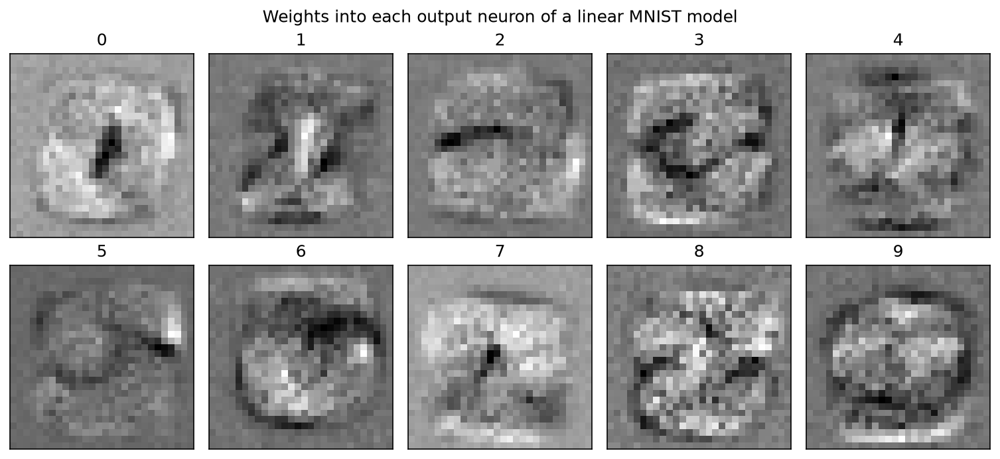
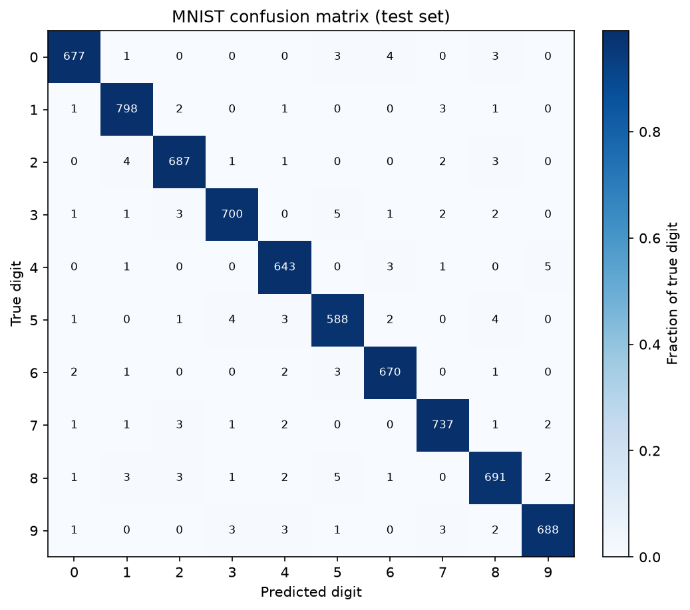
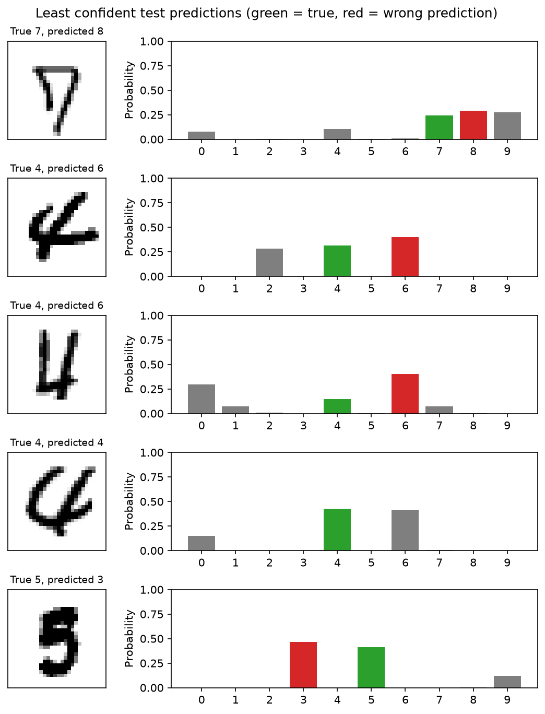

# Machine Learning Notes
This is a collection of my personal machine learning notes and code implementations. Largely based on the following resources:

- Lectures and slides by Dr. Ji
- Learning From Data textbook. 


<p>
  
  
  
</p>


# Contents

## Linear Models
- [Overview of Linear Models](LinearModels/linear_models.md)
- [Linear Regression](LinearModels/linear_regression.md)
    - [Numpy Implementation](LinearModels/linear_regression.py)
- [Perceptron](LinearModels/perceptron.md)
    - [Numpy Implementation](LinearModels/perceptron.py)
- [Binary Logistic Regression](LinearModels/binary_logistic_regression.md)
    - [Numpy Implementation](LinearModels/binary_logistic_regression.py)
- [Multiclass Logistic Regression](LinearModels/multiclass_logistic_regression.md)
    - [Numpy Implementation](LinearModels/multiclass_logistic_regression.py)

## Learning Techniques
- [Gradient Descent](LearningTechniques/gradient_descent.md)
- [Regularization](LearningTechniques/regularization.md)
    - [Neural Network Example](LearningTechniques/regularization.py)
- [Normalization](LearningTechniques/normalization.md)


## Neural Networks
- [Neural Networks](NeuralNetworks/neural_networks.md)
    - [Numpy Implementation](NeuralNetworks/neural_network.py)
- [Activation Functions](NeuralNetworks/activation_functions.md)
    - [Numpy Implementation](NeuralNetworks/activations.py)
- [Loss Functions](NeuralNetworks/loss_functions.md)
    - [Numpy Implementation](NeuralNetworks/loss.py)
- [Dropout](NeuralNetworks/dropout.md)
    - [Numpy Implementation](NeuralNetworks/dropout.py)
- [Batch Normalization](NeuralNetworks/batch_normalization.md)
    - [Numpy Implementation](NeuralNetworks/batch_norm.py)

## Convolutional Neural Networks
- [The Convolutional Layer](ConvolutionalNeuralNetworks/convolutional_layer.md)
    - [Numpy Implementation](ConvolutionalNeuralNetworks/convolution.py)
- [Pooling Layers](ConvolutionalNeuralNetworks/pool_layer.md)
    - [Numpy Implementation](ConvolutionalNeuralNetworks/pool.py)


# Setup
```bash
python -m venv .venv
source .venv/bin/activate
pip install -e .
```

Run any file directly, for example: 
```bash
python LinearModels/linear_regression.py
```