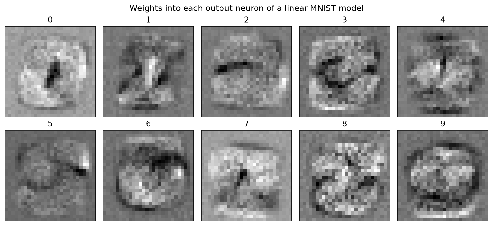
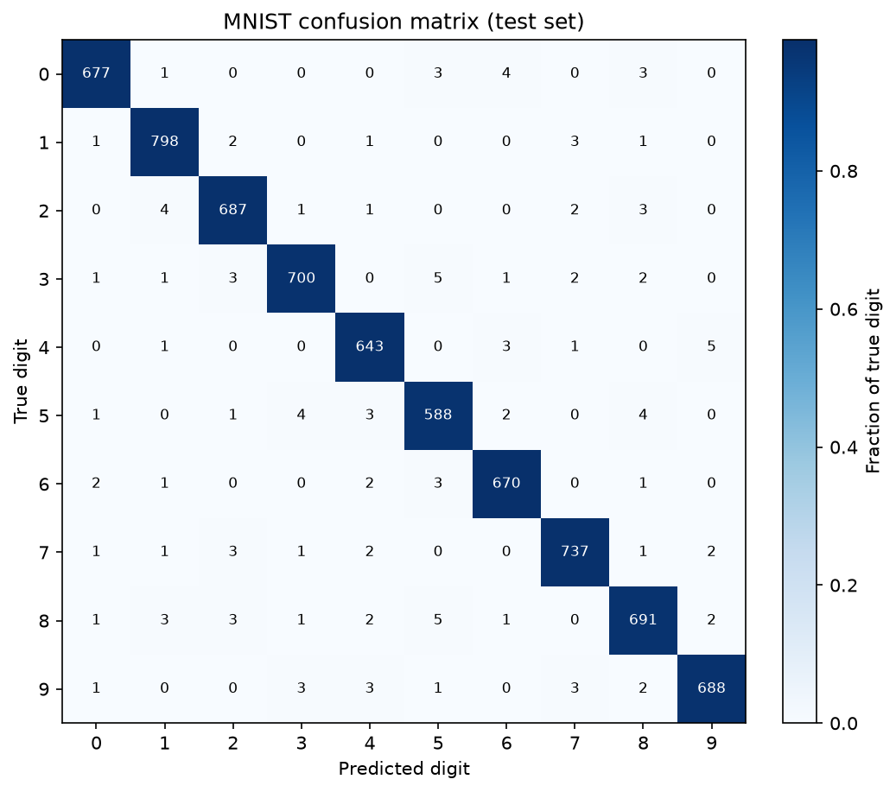
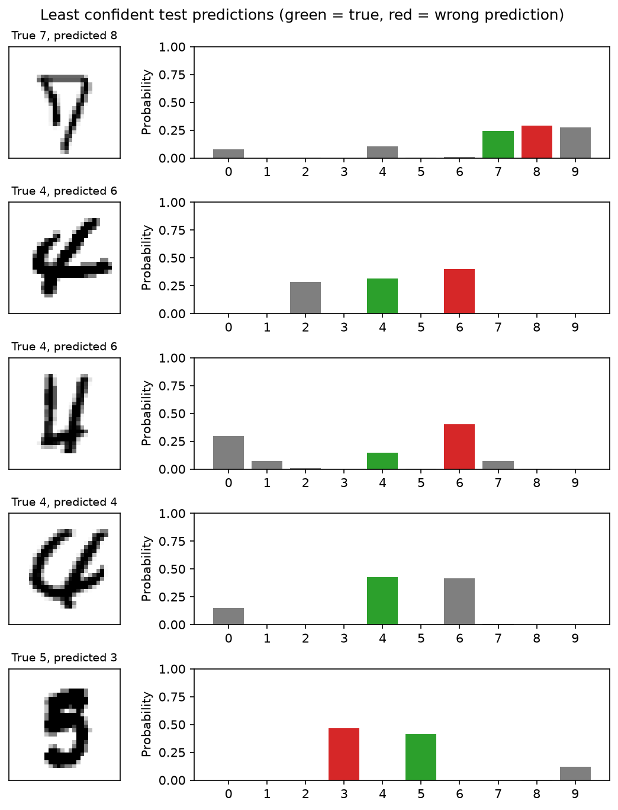

# Machine Learning Notes
This is a collection of my personal machine learning notes and code implementations. Largely based on the following resources:

- Lectures and slides by Dr. Ji
- Learning From Data textbook. 


<p>
  
  
  
</p>


# Contents

## Linear Models
- [Overview of Linear Models](LinearModels/linear_models.md)
- [Linear Regression](LinearModels/linear_regression.md)
    - [Numpy Implementation](LinearModels/linear_regression.py)
- [Perceptron](LinearModels/perceptron.md)
    - [Numpy Implementation](LinearModels/perceptron.py)
- [Binary Logistic Regression](LinearModels/binary_logistic_regression.md)
    - [Numpy Implementation](LinearModels/binary_logistic_regression.py)
- [Multiclass Logistic Regression](LinearModels/multiclass_logistic_regression.md)
    - [Numpy Implementation](LinearModels/multiclass_logistic_regression.py)

## Learning Techniques
- [Gradient Descent](LearningTechniques/gradient_descent.md)
- [Regularization](LearningTechniques/regularization.md)
    - [Neural Network Example](LearningTechniques/regularization.py)
- [Normalization](LearningTechniques/normalization.md)


## Neural Networks
- [Neural Networks](NeuralNetworks/neural_networks.md)
    - [Linear Layer Implementation](NeuralNetworks/linear.py)
    - [Network Implementation](NeuralNetworks/neural_network.py)
- [Activation Functions](NeuralNetworks/activation_functions.md)
    - [Numpy Implementation](NeuralNetworks/activations.py)
- [Loss Functions](NeuralNetworks/loss_functions.md)
    - [Numpy Implementation](NeuralNetworks/loss.py)
- [Dropout](NeuralNetworks/dropout.md)
    - [Numpy Implementation](NeuralNetworks/dropout.py)
- [Batch Normalization](NeuralNetworks/batch_normalization.md)
    - [Numpy Implementation](NeuralNetworks/batch_norm.py)

## Convolutional Neural Networks
- [Convolution](ConvolutionalNeuralNetworks/convolution.md)
- [The Convolutional Layer](ConvolutionalNeuralNetworks/convolutional_layer.md)
    - [Numpy Implementation](ConvolutionalNeuralNetworks/convolution.py)
- [Pooling Layers](ConvolutionalNeuralNetworks/pool_layer.md)
    - [Numpy Implementation](ConvolutionalNeuralNetworks/pool.py)
- [Residual Blocks](ConvolutionalNeuralNetworks/residual_block.md)
    - [Numpy Implementation](ConvolutionalNeuralNetworks/residual.py)


# Experiments

## MNIST
Every model was trained for 45 epochs with a batch size of 128. The linear model, neural network, and LeNet use a learning rate of 0.05. The ResNet uses learning rates of 0.1, 0.01, and 0.001 in three phases, with random-shift augmentation.

| Model | Test accuracy | Best training loss | Time per epoch |
|---|---|---|---|
| Linear | 91.63% | 0.2408 | 0.11s |
| Neural network | 97.66% | 0.0018 | 0.20s |
| LeNet | 99.03% | 0.0074 | 1.51s |
| ResNet-20 | 99.54% | 0.0049 | 22.77s |

## CIFAR-10

| Model | Test accuracy | Best training loss | Time per epoch |
|---|---|---|---|
| Linear | 29.15% | 3.0195 | 0.10s |
| Neural network | 49.31% | 0.4013 | 0.19s |
| LeNet | 63.72% | 0.6328 | 1.50s |
| ResNet-20 | 85.08% | 0.3506 | 28.43s |

# Setup
```bash
python -m venv .venv
source .venv/bin/activate
pip install -e .
```

Run any file directly, for example: 
```bash
python LinearModels/linear_regression.py
```